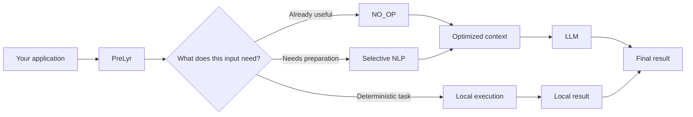
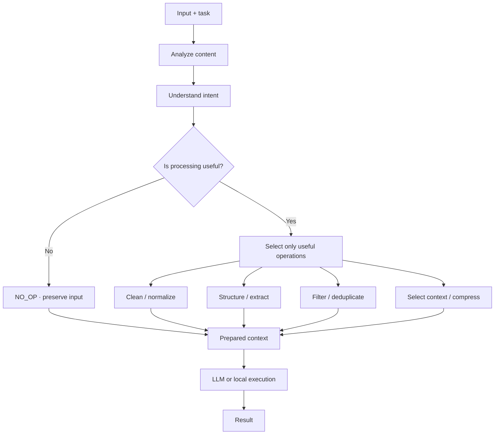
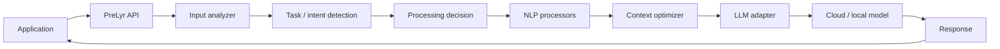
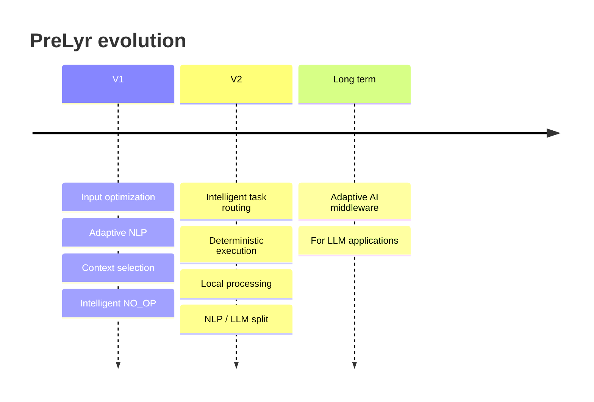

<div align="center">


# PreLyr

### Understand the input. Decide the work. Send only what matters.

<p>
  <strong>Adaptive NLP middleware for reducing unnecessary LLM work without throwing away useful information.</strong>
</p>

<p>
  <a href="#-quick-start">Quick Start</a> ·
  <a href="#-how-it-works">How It Works</a> ·
  <a href="#-use-cases">Use Cases</a> ·
  <a href="#-roadmap">Roadmap</a> ·
  <a href="#-contributing">Contributing</a>
</p>

<p>
  <a href="https://www.python.org/"></a>
  
  
  
  <a href="LICENSE"></a>
</p>

> **Minimize unnecessary LLM work — not information.**

</div>

---

## ✦ The idea in one screen

Most AI applications send every request directly to an LLM. PreLyr adds a decision layer first:



PreLyr is not trying to make every prompt shorter. It is trying to make every downstream operation more intentional.

## ✦ Why PreLyr?

| Without a decision layer | With PreLyr |
|---|---|
| Every request goes straight to the model | Each request is analyzed first |
| Large logs and repeated content consume context | Genuine noise and redundancy can be reduced |
| The same preprocessing is applied everywhere | Processing is selected for the task |
| Deterministic work may be sent to an LLM | Local execution can handle suitable work |
| Token reduction becomes the main metric | Correctness and unnecessary work come first |

<blockquote>
<strong>Minimum unnecessary context ≠ minimum context.</strong><br />
A smaller prompt is only better when the information required to solve the task is still present.
</blockquote>

## ✦ How It Works



### Processing decisions

<details>
<summary><strong>Open the decision catalog</strong></summary>

| Decision | What it does |
|---|---|
| `NO_OP` | Passes useful input through unchanged |
| `CLEAN` | Removes genuine noise |
| `NORMALIZE` | Makes inconsistent input easier to process |
| `STRUCTURE` | Adds useful structure to unstructured content |
| `EXTRACT` | Pulls out task-relevant information |
| `FILTER` | Removes content irrelevant to the task |
| `DEDUPLICATE` | Reduces genuine repetition |
| `SELECT_CONTEXT` | Keeps the context most relevant to the task |
| `COMPRESS` | Reduces unnecessary representation |
| `CHUNK` | Splits large content intelligently |
| `LOCAL_EXECUTION` | Handles suitable deterministic work locally |
| `LLM_REQUIRED` | Routes reasoning or generation to an LLM |

Multiple decisions can be combined when the input requires it.

</details>

## ✦ The PreLyr contract

PreLyr follows three rules before optimizing anything:

```text
1. Preserve meaning
2. Respect the task
3. Remove only unnecessary work
```

For example, this context may all matter:

```text
Current backend: Flask
Database: PostgreSQL
Possible future migration: FastAPI
```

PreLyr should not remove `Flask` merely because `FastAPI` appears later. It is **lossless-by-default** and conservative about information removal.

## ✦ Use Cases

<table>
<tr>
<td width="50%">

### 🧹 Noisy terminal logs

Find the useful failure inside thousands of lines of warnings, repeated output, and stack traces while preserving diagnostic context.

```text
Large log → analyze → select error context → LLM
```

</td>
<td width="50%">

### 📄 Large documents

For a task like **“find all deadlines”**, extract and structure deadline-related content instead of treating the entire document as one block.

```text
Document + task → extract → structured context
```

</td>
</tr>
<tr>
<td>

### 🔁 Repetitive input

Detect genuine duplication, reduce the representation, and preserve the meaning required by the task.

```text
Repeated content → deduplicate → preserve meaning
```

</td>
<td>

### ⚙️ Deterministic work

Route suitable operations to local execution instead of spending an LLM call on work that does not require reasoning or generation.

```text
Request → classify → local / NLP / LLM
```

</td>
</tr>
</table>

## ✦ Architecture



### Built around a small boundary

```text
Input understanding
        ↓
Selective processing
        ↓
Context optimization
        ↓
Task routing
        ↓
LLM interaction
```

**Design goals:** modular · extensible · model-agnostic · provider-agnostic · testable · observable · conservative about information loss.

## ✦ Quick Start

> Installation and usage will expand as the V1 API stabilizes.

### 1. Install

```bash
git clone https://github.com/mogesh-developer/PreLyr.git
cd PreLyr
python -m venv .venv
```

<details>
<summary><strong>Activate the virtual environment</strong></summary>

**Windows PowerShell**

```powershell
.venv\Scripts\activate
```

**Linux / macOS**

```bash
source .venv/bin/activate
```

</details>

### 2. Install PreLyr

```bash
pip install -e .
```

### 3. Integration concept

```python
from prelyr import PreLyr

prelyr = PreLyr()

prepared = prelyr.prepare(
    input=user_input,
    task=user_task,
)

response = llm.generate(prepared.context)
```

> The public API is expected to evolve while V1 is being built.

## ✦ V1 scope

<div align="center">

| ✅ In scope | ⏭️ Later direction |
|---|---|
| Input analysis | Intelligent task routing |
| Task / intent understanding | Deterministic local execution |
| Cleaning and normalization | NLP / LLM work splitting |
| Redundancy detection | Broader local workflows |
| Structure and extraction | — |
| Relevant-context selection | — |
| Selective compression | — |
| Intelligent `NO_OP` | — |

</div>

PreLyr is intentionally **not** a chatbot, a new LLM, a generic RAG platform, an autonomous-agent framework, a document-management system, or an NLP library built from scratch.

## ✦ Roadmap



## ✦ Project structure

```text
PreLyr/
├── prelyr/
│   ├── analyzer/
│   ├── processors/
│   ├── optimizer/
│   ├── routing/
│   ├── models/
│   └── core/
├── tests/
├── examples/
├── docs/
├── README.md
├── pyproject.toml
└── LICENSE
```

## ✦ Current status

> 🚧 **PreLyr V1 — Active Development**

The project is being built incrementally around one question:

> **Why should an LLM do work that does not actually require an LLM?**

## ✦ Contributing

Before adding a feature, ask:

- Does it reduce unnecessary LLM work?
- Does it improve input quality or task relevance?
- Is preprocessing actually necessary?
- Could the task be completed deterministically?
- Could the transformation remove important information?
- Does it belong in the current version?
- Should a mature library solve it instead?

## ✦ License

This project is licensed under the [MIT License](LICENSE).

<div align="center">

---

### PreLyr

**Prepare the input. Reduce the unnecessary work. Let the model focus on what matters.**

`Input → Understand → Decide → Optimize → LLM`

<br />


</div>
